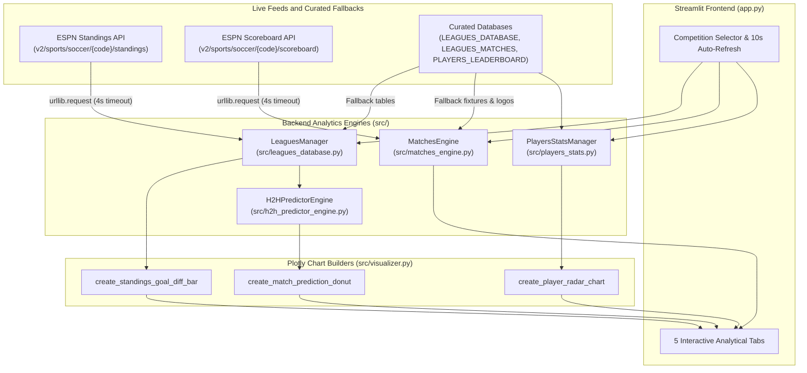

<h1 align="center">⚽ Global Football Intelligence &amp; Poisson H2H Analytics Platform</h1>

<p align="center">
  <strong>Interactive global football intelligence and match analytics dashboard built with Streamlit and Plotly — uniting live ESPN Soccer API standings and matchday scoreboards across 14 international competitions with Golden Boot leaderboards, 6-axis player radars, and a Poisson Expected Goals (xG) match outcome engine.</strong>
</p>

<p align="center">
  <a href="#-executive-overview--competition-coverage"><b>Overview &amp; Coverage</b></a> •
  <a href="#-dashboard-modules--core-engines"><b>Modules &amp; Engines</b></a> •
  <a href="#-mathematical-model-poisson-h2h-engine"><b>Poisson xG Model</b></a> •
  <a href="#-system-architecture"><b>Architecture</b></a> •
  <a href="#-repository-structure"><b>Structure</b></a> •
  <a href="#-installation--usage"><b>Installation &amp; Usage</b></a> •
  <a href="#-data-providers-disclaimers--license"><b>Data &amp; License</b></a>
</p>

<p align="center">
  
  =1.35.0" />
  =5.18.0" />
  
</p>

<p align="center">
  
  
  
  
</p>

---

## 🎯 Executive Overview & Competition Coverage

The **Global Football Intelligence & Poisson H2H Analytics Platform** provides a unified telemetry interface for tracking domestic leagues, continental club tournaments, and international championships. Built for sports analysts, quantitative modelers, and football enthusiasts, `app.py` combines live **ESPN Soccer API** standings and fixture scoreboards with resilient offline datasets, interactive Plotly charts, and probabilistic scoreline modeling.

### Supported Competitions (`src/leagues_database.py`)

`LeaguesManager` exposes **14 selectable competitions** across 6 confederations (`UEFA`, `AFC`, `CAF`, `CONCACAF`, `CONMEBOL`, `FIFA`), backed by ESPN competition mappings in `LEAGUE_TO_ESPN_CODE` (which also defines `uefa.europa` for UEFA Europa League API queries):

| Competition | ID | Confederation | Format | Teams | Reported Market Value | ESPN API Code |
|---|---|---|---|---:|---|---|
| **English Premier League** | `EPL` | UEFA | Domestic League | 20 | €11.85 Billion | `eng.1` |
| **Spanish La Liga** | `LFP` | UEFA | Domestic League | 20 | €5.12 Billion | `esp.1` |
| **Indian Super League (ISL)** | `ISL` | AFC | Domestic League | 13 | €52.4 Million | `ind.1` |
| **Italian Serie A** | `ISA` | UEFA | Domestic League | 20 | €4.75 Billion | `ita.1` |
| **German Bundesliga** | `BL1` | UEFA | Domestic League | 18 | €4.45 Billion | `ger.1` |
| **French Ligue 1** | `FL1` | UEFA | Domestic League | 18 | €3.68 Billion | `fra.1` |
| **Saudi Pro League** | `SPL` | AFC | Domestic League | 18 | €1.15 Billion | `ksa.1` |
| **Moroccan Botola Pro** | `BOT` | CAF | Domestic League | 16 | €148 Million | `mar.1` |
| **Major League Soccer (MLS)** | `MLS` | CONCACAF | Domestic League | 29 | €1.29 Billion | `usa.1` |
| **Brazilian Série A (Brasileirão)** | `BRA` | CONMEBOL | Domestic League | 20 | €1.55 Billion | `bra.1` |
| **UEFA Champions League** | `UCL` | UEFA | Continental Club Cup | 36 | €16.4 Billion | `uefa.champions` |
| **CAF Champions League** | `CAFCL` | CAF | Continental Club Cup | 16 | €480 Million | `caf.champions` |
| **AFC Champions League Elite** | `ACLE` | AFC | Continental Club Cup | 24 | €890 Million | `afc.champions` |
| **FIFA World Cup 2026** | `FWC2026` | FIFA | Global National Tournament | 48 | €24.5 Billion | `fifa.world` |

---

## 🧩 Dashboard Modules & Core Engines

The application organizes telemetry into a 5-card competition KPI header, a 10-second live auto-refresh toggle (`st_autorefresh`), and **5 interactive tabs**:

| Dashboard Tab | Core Module & Functions | Implemented Features & Outputs |
|---|---|---|
| **🏆 Standings & Form Guide** | `LeaguesManager.get_standings_df()` (`src/leagues_database.py`) + `create_standings_goal_diff_bar()` (`src/visualizer.py`) | Live/fallback league table (`MP`, `W`, `D`, `L`, `GF`, `GA`, `GD`, `Points`, `Recent Form`, `Qualification / Status`) plus horizontal color-coded Goal Difference spectrum bar chart. |
| **⚡ Live Match Center & Scores** | `MatchesEngine.get_league_matches()` (`src/matches_engine.py`) | Filterable match cards (`All Fixtures`, `LIVE`, `FT`, `UPCOMING`) with club badges (`CLUB_LOGOS_FALLBACK` / ESPN CDN), stadium and referee metadata, possession split bar, xG summary, and match event timelines. |
| **👟 Golden Boot & Playmakers** | `PlayersStatsManager.get_top_scorers_df()` & `get_top_assists_df()` (`src/players_stats.py`) | Curated Golden Boot tables (`Goals`, `Pens`, `MP`, `xG`, `Mins / Goal`) and Playmaker tables (`Assists`, `Key Passes`, `Big Chances`) across 7 competitions (EPL, La Liga, Bundesliga, Serie A, Saudi Pro League, UCL, ISL, defaulting to EPL for others). |
| **🎯 H2H Match Predictor Engine** | `H2HPredictorEngine.calculate_match_odds()` (`src/h2h_predictor_engine.py`) + `create_match_prediction_donut()` | Select any Home and Away club from the active competition table to compute Win/Draw/Loss probabilities, projected xG, Over 2.5 Goals %, BTTS %, and the top 3 most probable scorelines. |
| **🌟 Elite Player Radar Profiles** | `PlayersStatsManager.get_radar_players()` & `get_player_radar_metrics()` + `create_player_radar_chart()` | 6-axis Plotly `Scatterpolar` radar (`Pace`, `Shooting`, `Passing`, `Dribbling`, `Defending`, `Physicality`) with progress breakdowns for Kylian Mbappé, Erling Haaland, Lamine Yamal, Vinícius Júnior, Lallianzuala Chhangte, and Dimitrios Diamantakos. |

---

## 🧮 Mathematical Model: Poisson H2H Engine

`H2HPredictorEngine.calculate_match_odds()` in [`src/h2h_predictor_engine.py`](src/h2h_predictor_engine.py) models match outcomes using independent Poisson goal distributions for the Home and Away sides.

### 1. Expected Goals ($\lambda_{\text{home}}, \lambda_{\text{away}}$)

Given Home attack/defense ratings $(\alpha_H, \beta_H)$, Away attack/defense ratings $(\alpha_A, \beta_A)$, and a home-advantage factor $h_{\text{adv}}$:

$$\lambda_{\text{home}} = \alpha_H \cdot \beta_A \cdot h_{\text{adv}}, \qquad \lambda_{\text{away}} = \alpha_A \cdot \beta_H$$

When invoked from `app.py`, the engine uses its baseline parameters ($\alpha_H = 1.85$, $\beta_H = 1.05$, $\alpha_A = 1.45$, $\beta_A = 1.25$, $h_{\text{adv}} = 1.15$), which can be customized when calling `H2HPredictorEngine.calculate_match_odds()` directly.

### 2. Scoreline Probability Grid & Market Derivation

Goal counts $h, a \in \{0, 1, 2, 3, 4, 5\}$ are evaluated via the Poisson probability mass function:

$$P_{\text{Poisson}}(k; \lambda) = \frac{e^{-\lambda}\,\lambda^k}{k!}, \qquad P(H = h, A = a) = P_{\text{Poisson}}(h; \lambda_{\text{home}}) \cdot P_{\text{Poisson}}(a; \lambda_{\text{away}})$$

Over the $6 \times 6$ score matrix with normalizing constant $Z = \sum_{h=0}^{5} \sum_{a=0}^{5} P(H = h, A = a)$:

- **1X2 Outcome Probabilities**:
  $$P(\text{Home Win}) = \frac{100}{Z}\sum_{h > a} P(H=h, A=a), \quad P(\text{Draw}) = \frac{100}{Z}\sum_{h = a} P(H=h, A=a), \quad P(\text{Away Win}) = \frac{100}{Z}\sum_{h < a} P(H=h, A=a)$$
- **Over 2.5 Goals & BTTS**:
  $$P(\text{Over 2.5}) = 100 \sum_{h + a > 2.5} P(H=h, A=a), \qquad P(\text{BTTS}) = 100 \sum_{h \ge 1,\, a \ge 1} P(H=h, A=a)$$
- **Correct Scorelines**: Top 3 $(h, a)$ pairs ranked by descending $P(H = h, A = a)$.

---

## 🏗️ System Architecture



---

## 📂 Repository Structure

```text
football-intelligence-platform/
├── src/
│   ├── __init__.py                   # Package marker
│   ├── leagues_database.py           # 14 competitions, ESPN standings client & LeaguesManager
│   ├── matches_engine.py             # Live ESPN scoreboard parser, logo fallback & MatchesEngine
│   ├── players_stats.py              # Golden Boot, playmaker rankings & 6-axis radar profiles
│   ├── h2h_predictor_engine.py       # Independent Poisson xG & scoreline probability engine
│   └── visualizer.py                 # Plotly radar, win-probability donut & goal-diff bar charts
├── scratch/                          # Standalone SofaScore scraping/inspection prototypes
│   ├── inspect_sofascore_stealth.py
│   ├── sofascore_page.html
│   ├── test_selenium_sofascore.py
│   └── test_sofascore.py
├── app.py                            # Main Streamlit dashboard entrypoint (5 tabs + 10s refresh)
├── scratch_test_live.py              # Standalone CLI script to test ESPN EPL scoreboard ingestion
├── requirements.txt                  # Python dependencies
├── LICENSE                           # Apache License 2.0
├── .gitattributes                    # Git text/EOL attributes
└── .gitignore                        # Python/venv/env ignore rules
```

---

## 🚀 Installation & Usage

### Prerequisites

- **Python**: `3.10+`
- **Dependencies** (`requirements.txt`): `streamlit>=1.35.0`, `pandas>=2.0.0`, `numpy>=1.24.0`, `requests>=2.31.0`, `plotly>=5.18.0`, `scipy>=1.11.0`, `streamlit-autorefresh>=1.0.1`
- No API keys or `.env` configuration are required — live feeds use public ESPN endpoints with built-in offline fallbacks.

### 1. Clone the Repository

```bash
git clone https://github.com/khalid-naami/football-intelligence-platform.git
cd football-intelligence-platform
```

### 2. Create Virtual Environment & Install Dependencies

**Windows (PowerShell):**

```powershell
python -m venv .venv
.\.venv\Scripts\Activate.ps1
pip install -r requirements.txt
```

**macOS / Linux:**

```bash
python3 -m venv .venv
source .venv/bin/activate
pip install -r requirements.txt
```

### 3. Launch the Dashboard

```bash
streamlit run app.py
```

### 4. Optional: Verify Live ESPN Feed Ingestion via CLI

```bash
python scratch_test_live.py
```

---

## 🌐 Data Providers, Disclaimers & License

### External Data Feeds

- **ESPN Soccer API (Standings)**: `https://site.api.espn.com/apis/v2/sports/soccer/{league_code}/standings`
- **ESPN Soccer API (Scoreboard)**: `https://site.api.espn.com/apis/site/v2/sports/soccer/{league_code}/scoreboard`
- **ESPN Team Logos CDN**: `https://a.espncdn.com/i/teamlogos/soccer/500/*.png`

### Analytical Notice

- When the public ESPN scoreboard API omits granular in-match telemetry (`xG`, `possession`, `shots`) or when offline curated match fallbacks are active, `src/matches_engine.py` generates synthetic values and simulated live clock ticks for dashboard demonstration.
- The Poisson H2H predictor is provided strictly for educational and sports analytics experimentation and is not intended for wagering or financial advice.

### License

Distributed under the **Apache License 2.0**. See [`LICENSE`](LICENSE) for full terms.
